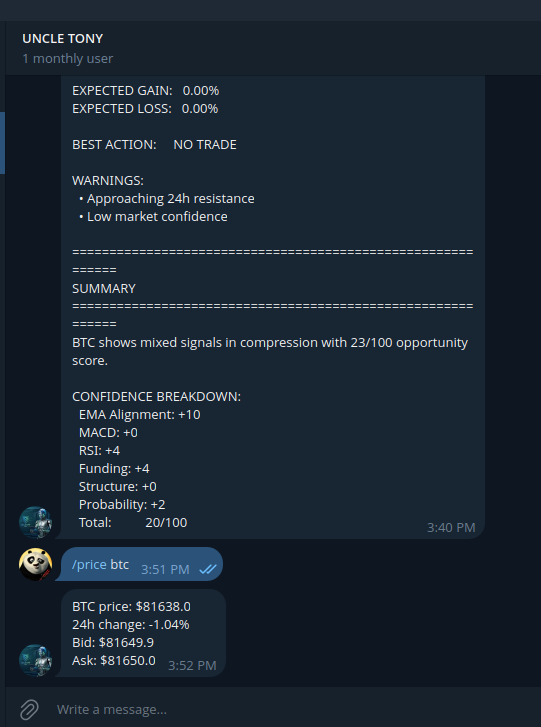
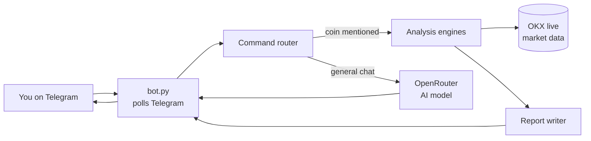

# Uncle Tony 🤖📈

**A Telegram crypto assistant that gives you live market analysis and AI chat, right in your chat app.**

Ask Uncle Tony about a coin and he pulls live market data from OKX, runs it through his own rule-based analysis engine, and replies with a full report: trend, key price levels, risk, possible scenarios and a suggested trading plan. Ask him anything else and he answers through an AI model.

<p align="center"></p>

> ⚠️ **Not financial advice.** This is a learning and showcase project. Do your own research before trading.

---

## What it can do

| Message | What you get |
|---|---|
| `/price BTC` | Current price, 24h change, bid and ask |
| `/analysis ETH` | Full market analysis report |
| `/intelligence SOL` | Market intelligence dashboard |
| `/tactical BTC` | Pure rule-based analysis, no AI used |
| `/analyze BTC` | Report from the AnalysisObject pipeline |
| `What do you think about BTC?` | Spots the coin in your message and analyses it |
| `hello` or any question | An AI chat reply |
| `/clear` | Clears the conversation memory |
| `/help` | Shows the command menu |

Supported coins include BTC, ETH, SOL, XRP, DOGE, ADA, BNB, AVAX, TON, LINK, SUI, PEPE and more.

### What goes into a report
- **Live data:** price, 24h high and low, volume, funding rate and open interest from OKX
- **Indicators:** RSI, EMA20 and EMA50, trend direction
- **Key levels:** support and resistance
- **Scenarios:** bullish, bearish and sideways probabilities
- **Risk and opportunity:** a risk level and an opportunity score out of 100, each with its reasons
- **Trading plan:** a suggested action such as BUY, SELL or WAIT, with stop loss and take profit when there's a setup

## How it works



1. **`bot.py`** checks Telegram for new messages every few seconds.
2. The **command router** (`core/command_router.py`) decides what kind of message it is.
3. For coins, the **analysis engines** (`services/`) fetch live OKX data and compute indicators, probabilities and a decision. Then the **local narrator** writes the report.
4. For general chat, the bot sends the conversation to an **AI model through OpenRouter** (`core/backends.py`).

**Built so it never goes silent.** The analysis is rule-based code, so it works even if the AI is down. If the AI fails or hits a limit, the bot still sends a helpful reply. If one piece of market data is missing, the report is built from the rest.

## Tech stack

- **Python 3.12**, using `requests` and `python-dotenv`
- **Telegram Bot API**, with long polling, so no web server is needed
- **OKX** public market data through the [OKX CLI](https://www.npmjs.com/package/@okx_ai/okx-trade-cli), with no OKX account needed
- **OpenRouter** for AI chat, using free models with automatic fallback
- **systemd** to run the bot in the background on Linux
- **pytest** for the test suite (116 tests)

## Run it yourself

### 1. What you need
- Python 3.12+ and Node.js (for the OKX CLI)
- A Telegram bot token: message [@BotFather](https://t.me/BotFather) on Telegram and send `/newbot`
- An OpenRouter API key: create one at [openrouter.ai/settings/keys](https://openrouter.ai/settings/keys). Free models cost nothing.

### 2. Install
```bash
git clone https://github.com/UncleTony01/telegram-agent.git
cd telegram-agent
python3 -m venv .venv
source .venv/bin/activate
pip install -r requirements.txt
npm install -g @okx_ai/okx-trade-cli
```

### 3. Configure
```bash
cp .env.example .env
```
Then open `.env` and fill in your values. `.env` holds your secrets, and git is set up never to upload it.

To find your `CHAT_ID`, send your bot a message, then open `https://api.telegram.org/bot<YOUR_TOKEN>/getUpdates` in a browser and look for `"chat":{"id": ...}`.

### 4. Run
```bash
python bot.py
```

### 5. Keep it running in the background (Linux)
```bash
mkdir -p ~/.config/systemd/user
cp deploy/uncle-tony.service ~/.config/systemd/user/
systemctl --user daemon-reload
systemctl --user enable --now uncle-tony
loginctl enable-linger "$USER"   # start at boot, even before you log in
```
Useful commands:
```bash
systemctl --user status uncle-tony     # is it running?
journalctl --user -u uncle-tony -f     # watch the live log
systemctl --user restart uncle-tony    # restart after changing .env
```

### Run the tests
```bash
python -m pytest -q
```

## Project structure

```
telegram-agent/
├── bot.py               # Entry point: Telegram polling loop
├── config.py            # Loads settings from .env
├── core/                # Command router, AI backends, prompts, analysis pipeline
├── handlers/            # Chat message handling and fallbacks
├── services/            # Market data (OKX), analysis engines, report writer
├── memory/              # Per-chat conversation memory
├── utils/               # Logging and chat access filter
├── deploy/              # systemd service file
├── docs/                # Architecture notes and roadmap
└── tests/               # pytest test suite
```

## Roadmap

- [ ] Keep conversation memory after a restart
- [ ] Automatic market scanner alerts (the scanner is built but not switched on yet)
- [ ] Watchlist command
- [ ] Cloud hosting so it stays online 24/7

## Author

**Anthony Muthoka** ([UncleTony01](https://github.com/UncleTony01))
